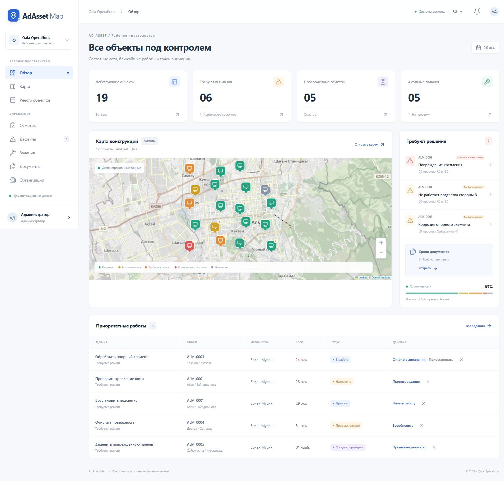

# AdAsset Map

Рабочая платформа одной компании-оператора для учёта рекламных конструкций, осмотров и ремонта. Русский и казахский интерфейс, адаптивная карта, серверная база PostgreSQL, закрытые файлы и реальные изменения состояния.

**Основной цикл:** создать конструкцию → проверить карточку → провести осмотр → зарегистрировать дефект → назначить работу → приложить результат → независимо подтвердить устранение.



## Быстрый запуск на Windows

Требуется Node.js 24 LTS и Git. Docker для локальной версии не нужен.

```powershell
git clone https://github.com/NKurmanali/adasset-map.git
cd adasset-map
npm ci
node scripts/setup.mjs
npm run build
npm start
```

Открыть **http://127.0.0.1:3000**. Логин администратора: `admin@adasset.local`. Случайный пароль записывается только в локальный файл `.local-access.txt` и не попадает в Git.

На подготовленном ноутбуке можно запускать `Start-AdAsset.ps1`: он сохраняет PID фонового сервера и открывает браузер. `Stop-AdAsset.ps1` останавливает только этот сервер. После обновления исходников остановите сервер, выполните `npm ci` и `npm run build`, затем запустите его снова.

Для разработки: `npm run dev`. **Не запускайте два процесса с одной локальной базой.** Сначала остановите текущий сервер, прежде чем выполнять `npm run db:migrate` или резервное копирование. Повторное открытие базы в другом процессе блокируется.

## Локальные учётные записи

Все семь демонстрационных аккаунтов используют пароль из `.local-access.txt`:

| Email | Роль |
| --- | --- |
| `admin@adasset.local` | Администратор |
| `manager@adasset.local` | Менеджер объектов |
| `dispatcher@adasset.local` | Диспетчер |
| `inspector@adasset.local` | Инспектор |
| `technician@adasset.local` | Техник |
| `leader@adasset.local` | Руководитель |
| `observer@adasset.local` | Наблюдатель |

Пароль задаётся при **первом** создании базы. Изменение `DEMO_PASSWORD` после инициализации не меняет существующие пароли. Локальный сервер слушает только `127.0.0.1`. Для работы с нескольких устройств настройте HTTPS, серверный PostgreSQL и отдельные аккаунты; не публикуйте локальную демоверсию с общим паролем.

## Что реализовано

- Обзор сети, карта Leaflet с кластеризацией, легендой, поиском, фильтрами и карточкой объекта. Выбор координат новой конструкции на карте. Реестр работает независимо от картографических тайлов.
- Отдельные состояния карточки, жизненного цикла, технического состояния, осмотра и документов. Новая конструкция без осмотра имеет неизвестное состояние.
- Черновик и проверка карточки; контроль уникального номера; предупреждение о близких координатах; поверхности A/B и дополнительные поверхности; история переноса и демонтажа.
- Неизменяемые завершённые осмотры, версионируемые шаблоны чек-листов, дополнения с причиной, фотографии, отдельные дефекты и добровольная геопозиция.
- Планы с периодичностью и двумя правилами следующей даты; внеплановые осмотры; идемпотентный серверный планировщик.
- Регистрация, приоритизация, отклонение с причиной и объединение дубликатов дефектов. Критический сигнал виден до назначения работ.
- Задания на один объект с несколькими дефектами, сотрудником и бригадой; принятие, начало, пауза с причиной и следующим шагом, отмена, отчёт с фото до/после и расходами, независимая проверка, возврат на доработку.
- Частичное закрытие: подтверждаются только выбранные устранённые дефекты. Отмена задания или передача на проверку не закрывает дефекты. Исполнитель, включая пользователя с несколькими ролями, не может принять свою работу.
- Документы с файлами, сроками и проверкой; бессрочные документы; продление отдельной записью с сохранением оригинала; настраиваемые требования и интервалы напоминаний.
- Приватная загрузка JPEG/PNG/WebP/PDF/TXT до 10 МБ, проверка сигнатур изображений/PDF, выдача ссылок на 60 секунд после проверки сессии. Файлы сохраняются вне `public/`.
- Пользователи, несколько ролей, бригады, владельцы и обслуживающие организации; серверные проверки доступа; внутренние уведомления и отметки прочтения; история и аудит.
- Отчёты по районам, владельцам, типам, категориям дефектов, сотрудникам, срокам и фактическим расходам; CSV с проверкой прав и защитой от формул.
- QR-этикетка без контактных данных, загрузка PNG, печать и сканирование камерой. QR открывает обычную карточку после входа.
- Локальные черновики осмотра и отчёта о ремонте с восстановлением, статусом отправки, идемпотентными повторными запросами и предупреждением перед выходом.
- 20 вымышленных объектов в Алматы, 3 владельца и обслуживающая организация, 2 бригады, разные состояния, сроки и этапы работ, объект с двумя дефектами и демонтированный объект. Иллюстрации и текстовые демодокументы реально открываются.

## Стек и хранение

Next.js 16.4, React 19, TypeScript, Tailwind CSS 4, React Hook Form + Zod, Leaflet + MarkerCluster, PostgreSQL, Supabase SDK, QRCode и html5-qrcode.

В локальном режиме PostgreSQL работает через **PGlite** внутри серверного Node.js-процесса и сохраняется в `.data/postgres/`; браузер не является базой данных. Файлы лежат в `.data/files/`. Перезапуск приложения и обновление страницы сохраняют бизнес-записи, файлы и историю. Локальная авторизация использует scrypt и непрозрачные сессии с HttpOnly / SameSite=Strict cookie. HTTPS включает Secure cookie. Срок сессии — 12 часов; есть ограничение попыток входа.

Если задан `DATABASE_URL`, используется обычный PostgreSQL через `pg`. Если `AUTH_PROVIDER=supabase`, пароль проверяется Supabase Auth, затем приложение выдаёт свою 12-часовую сессию. `STORAGE_PROVIDER=supabase` включает приватный бакет Supabase Storage. Эти адаптеры реализованы, но на подготовленном ноутбуке работают локальные провайдеры: облачные ключи не предоставлены.

## Структура

```text
src/app/                 страницы и API
src/components/          интерфейс, карта и формы операций
src/lib/domain.ts        расчёт состояний и общие правила
src/lib/service.ts       транзакции, права, переходы и планировщик
src/lib/db.ts            адаптеры PGlite / PostgreSQL и миграции
src/lib/security.ts      авторизация, сессии и проверка origin
src/lib/seed.ts          вымышленные данные и реальные демофайлы
migrations/001_core.sql  таблицы, связи, индексы и ограничения
supabase/               PostGIS, RLS и приватный бакет
tests/                  интеграционные проверки критической логики
scripts/                настройка, миграции, резервирование и подключение пользователей
docs/                   архитектура, эксплуатация, ограничения и проверка
```

## Команды

```sh
npm test              # интеграционные тесты в отдельной PostgreSQL-базе в памяти
npm run typecheck     # проверка TypeScript
npm run build         # производственная сборка
npm run db:migrate    # миграции и первичное заполнение; локальный сервер должен быть остановлен
npm run backup        # резервная копия; локальный сервер должен быть остановлен
npm run scheduler     # опциональный вызов работающего /api/cron с CRON_SECRET
```

Планировщик внутри приложения запускается раз в минуту. Для серверов без постоянно работающего Node.js-процесса используйте защищённый `POST /api/cron` из внешнего планировщика. Закрытие ноутбука останавливает вычисления и уведомления; при следующем запуске просроченные события обрабатываются без дублей.

Подробности: [развёртывание и резервирование](docs/OPERATIONS.md), [правила и архитектура](docs/ARCHITECTURE.md), [проверки и ограничения](docs/ACCEPTANCE.md).

## Границы версии

Локальный запуск полностью готов. Облачная Supabase-конфигурация и PostGIS-миграция поставлены в исходниках и требуют применения к реальному проекту. Локальный PGlite использует индекс по координатам, а не PostGIS. Email, геокодирование, полноценные офлайн-карты, фоновая синхронизация закрытого браузера, продажи рекламных мест, платежи, склад, бухгалтерия и управление LED-контентом не подключены.

Фотографии демонстрационных объектов заменены явно подписанными оригинальными SVG-иллюстрациями. Настоящие пользовательские фото загружаются в JPEG/PNG/WebP. Казахский язык покрывает основные экраны, формы, статусы и навигацию; пользовательские тексты, демонстрационные справочники и подробные серверные ошибки не переводятся автоматически.
